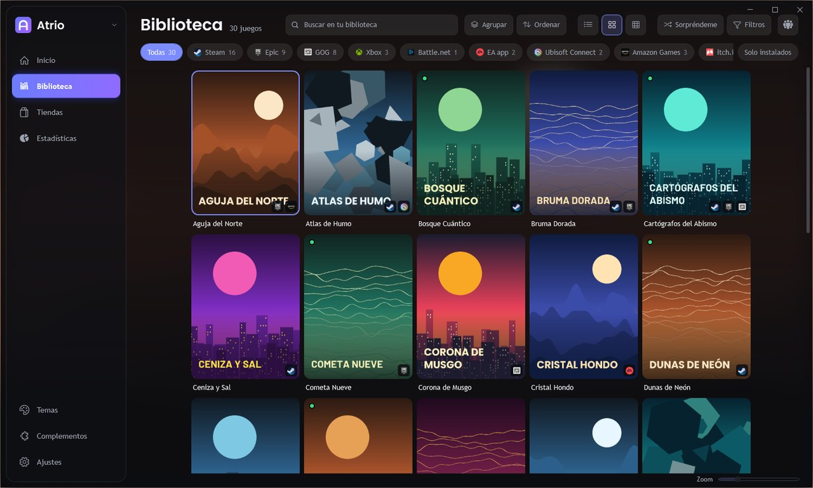

# Atrio

Un solo sitio para los juegos de todas tus tiendas. Atrio es un lanzador portátil para Windows basado en [Playnite](https://github.com/JosefNemec/Playnite): no se instala, no escribe en el registro y guarda todo dentro de su carpeta.

*A portable game launcher for Windows based on Playnite. It brings every store together, merges duplicates and lets you choose where to play each game.*



> Las imágenes usan una biblioteca de ejemplo con juegos que no existen, generada por `atrio/demo/generar.py`.

## Qué aporta

- **Un juego, una entrada.** Si tienes el mismo juego en varias tiendas aparece una sola vez, con el icono de cada tienda en la portada.
- **Tú eliges desde dónde jugar.** La ficha del juego muestra cada copia, con su botón de jugar o instalar. También puedes fijar una tienda por defecto o separar una copia que no sea el mismo juego.
- **Tiendas listas desde el primer arranque.** Steam, Epic, GOG, Xbox, Battle.net, EA, Ubisoft, Rockstar, Riot, Amazon, Humble e itch.io vienen activas. Otras once se activan con un clic y cuatro más se descargan desde la página Tiendas.
- **Interfaz nueva.** Inicio con portada que rota, botones con texto, color ambiental de cada juego y un menú de temas con vista previa, además de color de acento al momento.
- **Compatible con Playnite.** Atrio carga los complementos y temas de Playnite 10 y puede copiar tu biblioteca sin tocar la original.

## Empezar

1. Descarga el `.zip` de la última versión en [Releases](https://github.com/ElKiro1311/Atrio/releases).
2. Descomprímelo en una carpeta donde tengas permiso de escritura, por ejemplo `D:\Atrio`. Evita `Archivos de programa`.
3. Abre `Atrio.exe`.

Requisitos: Windows 10 o 11. El programa no está firmado, así que Windows puede avisar la primera vez.

Si tienes Playnite, ciérralo antes del primer arranque y Atrio te ofrecerá copiar tu biblioteca, tus imágenes y tus sesiones.

## Compilar

Hace falta Windows, Python 3 y conexión a internet. Si no tienes .NET SDK, el script baja uno a `.herramientas\` sin instalar nada.

```powershell
powershell -ExecutionPolicy Bypass -File atrio\herramientas\compilar.ps1
```

El resultado queda en `salida\Atrio`. Con `-Zip` crea además el paquete para publicar. Con `-Banco` añade el banco de pruebas fuera de pantalla, descrito en `source\Playnite.DesktopApp\Atrio\AtrioCaptura.cs`.

Para regenerar el logo, la biblioteca de ejemplo o las vistas previas hacen falta Pillow y PyYAML: `python -m pip install --target .herramientas\py pillow pyyaml`.

| Carpeta | Contenido |
|---|---|
| `source/` | El código. Lo propio de Atrio está en las carpetas `Atrio` y en los archivos `Atrio*` |
| `atrio/temas/` | Temas: `base/`, una carpeta por variante, `variantes.py` (colores), `fuentes/`, `vistas/` |
| `atrio/complementos/` | Lista fijada de complementos con su versión, huella y licencia |
| `atrio/herramientas/` | Scripts de compilación |
| `atrio/demo/` | Generador de la biblioteca de ejemplo |
| `atrio/pruebas/` | Banco de pruebas y pruebas unitarias |

## Lo que Atrio no hace

Atrio no incluye juegos, ROM, BIOS ni claves, ni ayuda a conseguirlos. Tampoco salta ningún DRM: cada juego se abre con su tienda.

Para no depender de un tercero, Atrio no usa los servidores de Playnite. El buscador de complementos lee la [base pública de complementos](https://github.com/JosefNemec/PlayniteAddonDatabase). Dos excepciones quedan fuera de nuestro control:

- Los complementos oficiales se actualizan desde `playnite.link`, que es donde los publican sus autores.
- El complemento oficial de Steam llama a un servicio de Playnite solo como plan B, si Steam no le da la lista de juegos.

El proveedor de metadatos IGDB no viene incluido porque depende de ese servicio. Quien lo quiera puede instalarlo desde Complementos.

## Créditos y licencias

Atrio es una versión modificada de [Playnite](https://github.com/JosefNemec/Playnite), de Josef Nemec y colaboradores, y se publica con la misma licencia [MIT](LICENSE.md). Las dependencias de Playnite aparecen en [`source/Playnite/license.txt`](source/Playnite/license.txt).

Los complementos incluidos son obra de sus autores: cada uno figura en [`atrio/complementos/lista.json`](atrio/complementos/lista.json) con su licencia, y el paquete lleva el texto de todas en `licencias-complementos.txt`. Solo se incluyen los que permiten redistribuirlos.

Las fuentes Poppins y Barlow usan la [SIL Open Font License](atrio/temas/fuentes).

Atrio no está afiliado a Playnite, Valve, Epic Games, Microsoft ni a ninguna otra tienda. Los nombres y logotipos son de sus dueños y se usan solo para identificar cada tienda.

Consulta también la [política de seguridad](SECURITY.md).
