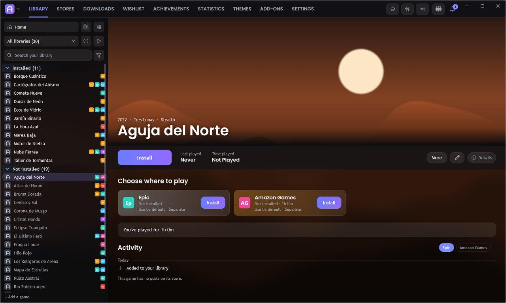

# Atrio

**English** · [Español](README.es.md)

One place for the games of all your stores. Atrio is a portable launcher for Windows based on [Playnite](https://github.com/JosefNemec/Playnite): it isn't installed, it doesn't write to the registry and it keeps everything inside its folder. The interface is in English and Spanish.



> The images use a sample library with games that don't exist, generated by `atrio/demo/generate.py`.

## What it brings

- **One game, one entry.** If you own the same game in several stores it appears only once, with each store's icon on the cover.
- **You choose where to play from.** The game's page shows every copy, with its own play or install button. You can also set a default store or separate a copy that isn't the same game.
- **Install without going through the store.** Atrio asks the store to do it and the game downloads with the percentage on the button. Steam, Xbox, Epic, Amazon and itch.io do it by themselves. EA, Ubisoft and GOG stop at the game's terms so that you accept them, unless you turn on an option. The store has to be on your PC with your account signed in, and if something fails it opens as usual.
- **Stores ready from the first start.** Steam, Epic, GOG, Xbox, Battle.net, EA, Ubisoft, Rockstar, Riot, Amazon, Humble and itch.io come enabled. Another eleven are enabled with one click and four more are downloaded from the Stores page.
- **Achievements in one place.** It reads the achievements from your stores and from RetroAchievements, shows them on each game's page and lets you know when you unlock one while playing. It only reads them: each account has to be connected.
- **Emulators as one more store.** Atrio recognizes 89 emulators. Each one has its card, its library filter and its icon on the covers. It doesn't include emulators, games or BIOS files.
- **Its own browser.** Links to stores, news and game pages open inside Atrio, for every store. It uses the Edge engine that comes with Windows (WebView2), so trailers play with sound. You can choose another browser in Settings.
- **Browser extensions.** In Stores you can turn on SteamDB and Augmented Steam to see the lowest price, the prices in other stores and the player counts on the Steam store. They are downloaded from the Chrome Web Store when you turn them on.
- **Friends on the game page.** If you're signed in to Steam in that browser, the page shows which friends play each game.
- **Each store's activity.** Under each title you get what the store you use for that game publishes, with its patch notes, next to what you've played and the achievements you've earned.
- **Steam cards and badges.** The game page shows the ones you have, the ones you're missing and the badge's level.
- **OptiScaler next to "Play".** With the features of [OptiScaler Client](https://github.com/Optiscaler-Client/Optiscaler-Client), which is only downloaded if you ask for it. Stable, beta or nightly versions, and OptiScaler's compatibility list one click away. A new version of the client is tested before it's used: if it doesn't fit, the one that worked stays.
- **Collections.** You fill them yourself, by right-clicking, dragging or picking games from a list, or they fill themselves from a few filters. Each one has its own page and can come out as a shelf on Home.
- **It updates itself.** Atrio watches this repository's Releases, with no account, shows what's new and installs with one click. If something fails it stays as it was, and your library and settings aren't touched.
- **A new interface.** Menu at the top and library on the left, with a store picker and a search box. A Home with news, recent games and what to play next. A game page with a header, a play bar, activity and achievements that adapts from laptops to ultrawide screens. Seven themes.
- **Compatible with Playnite.** Atrio loads Playnite 10 add-ons and themes and can copy your library without touching the original.

## Getting started

1. Download `Atrio.zip` from the latest version in [Releases](https://github.com/ElKiro1311/Atrio/releases).
2. Unpack it somewhere you can write to, for example `D:\`: everything goes inside an `Atrio` folder. Avoid `Program Files`.
3. Open `Atrio.exe`, inside that folder.

The other package of each version, `Atrio-<version>.zip`, is the one automatic updates use. It has the same contents, without the folder.

Requirements: Windows 10 or 11. The program isn't signed, so Windows may warn you the first time.

If you have Playnite, close it before the first start and Atrio will offer to copy your library, your images and your sessions.

## Building

You need Windows, Python 3 and an internet connection. If you don't have a .NET SDK, the script downloads one to `.tools\` without installing anything.

```powershell
powershell -ExecutionPolicy Bypass -File atrio\tools\build.ps1
```

The result is left in `output\Atrio`. With `-Zip` it also creates the package to publish. With `-Bench` it adds the off-screen test bench, described in `source\Playnite.DesktopApp\Atrio\AtrioCaptura.cs` (the bench is still in Spanish: its commands are used by test scripts outside this repository).

To generate the logo, the sample library or the previews again you need Pillow and PyYAML: `python -m pip install --target .tools\py pillow pyyaml`.

To publish a version, write what's new in `atrio\release-notes\<version>.md` (English first and Spanish in a block at the end, like the others), push it to `main` and run `atrio\tools\publish.ps1 -Version <version>-beta` from a clean copy, or the "Publish" workflow on GitHub. It builds the package and creates the Release, and Atrio finds it by itself.

| Folder | Contents |
|---|---|
| `source/` | The code. What belongs to Atrio is in the `Atrio` folders and in the `Atrio*` files |
| `atrio/themes/` | Themes: `base/`, one folder per variant, `variants.py` (colors), `fonts/`, `previews/` |
| `atrio/addons/` | Pinned list of add-ons with their version, hash and license |
| `source/local-packages/` | `Playnite.Deps`, the binary libraries that Playnite only publishes on its own package server, so that building doesn't depend on it |
| `atrio/tools/` | Build and publishing scripts |
| `atrio/release-notes/` | What each version brings, which Atrio shows before updating |
| `atrio/demo/` | Generator of the sample library |
| `atrio/tests/` | Test bench and unit tests |

Some names stay in Spanish because installed copies read them: `atrio/complementos/bloqueados.txt`, the `complementos` release, `atrio-archivos.txt` in the package and the data files in Atrio's folder.

## What Atrio doesn't do

Atrio doesn't include games, ROMs, BIOS files or keys, and doesn't help you get them. It doesn't bypass any DRM either: each game opens with its own store.

Atrio doesn't use Playnite's servers, neither when running nor when building. The add-on browser reads the [public add-on database](https://github.com/JosefNemec/PlayniteAddonDatabase), the official add-ons it includes are updated with each Atrio version, and the Steam add-on's fallback is turned off.

The IGDB metadata provider isn't included because it depends on those servers. Anyone who wants it can install it from Add-ons.

## Credits and licenses

Atrio is a modified version (a fork) of [Playnite](https://github.com/JosefNemec/Playnite), by Josef Nemec and contributors, and is published under the same [MIT](LICENSE.md) license. Playnite's dependencies are listed in [`source/Playnite/license.txt`](source/Playnite/license.txt).

It's an independent project: if you find a bug, report it here and not to Playnite.

Achievements rely on [Playnite Achievements](https://github.com/justin-delano/PlayniteAchievements), by Justin Delano (MIT). Atrio includes an adapted copy: name, Spanish translation and without a sound whose license isn't stated.

[OptiScaler Client](https://github.com/Optiscaler-Client/Optiscaler-Client), by Agustinm28, is a separate program under the GPL-3.0 license. Atrio doesn't include it or modify its files: it downloads it from its page when the user asks for it and, on starting it, loads into it a module of its own (`source/Atrio.OptiScaler`, under Atrio's MIT license) to talk to it. [OptiScaler](https://github.com/optiscaler/OptiScaler) is the work of its authors. Neither is an official product of the stores or the graphics card makers.

The included add-ons are the work of their authors: each one is listed in [`atrio/addons/list.json`](atrio/addons/list.json) with its license, and the package carries the text of all of them in `addon-licenses.txt`. Only those that allow redistribution are included.

The Poppins and Barlow fonts use the [SIL Open Font License](atrio/themes/fonts). The [IcoFont](https://icofont.com) icons use [CC BY 4.0 and SIL OFL](references/Fonts/LICENSE-IcoFont.txt).

Atrio isn't affiliated with Playnite, Valve, Epic Games, Microsoft or any other store. Names and logos belong to their owners and only identify each store. This repository doesn't include their logos: each store's add-on provides them.

See also the [security policy](SECURITY.md).
